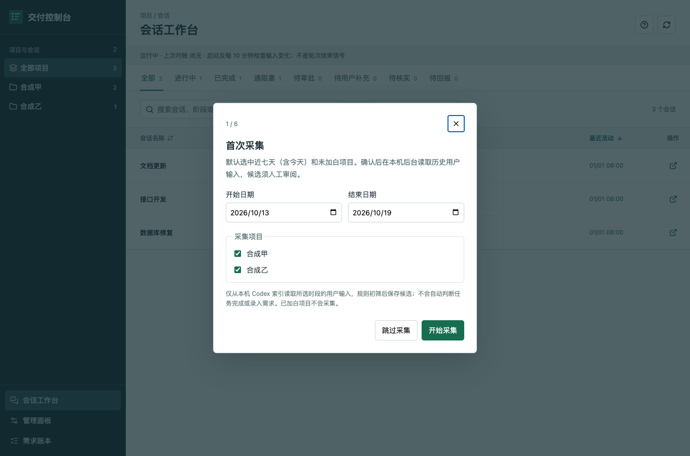
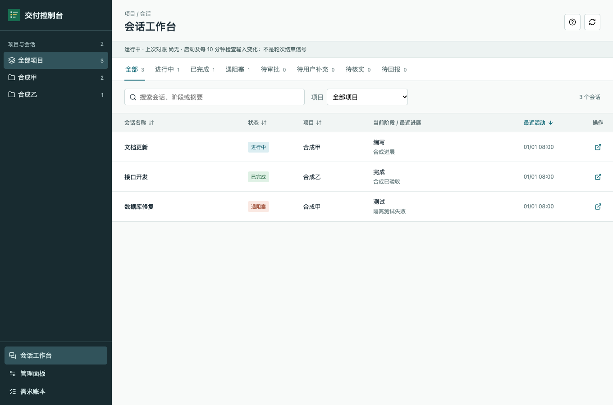
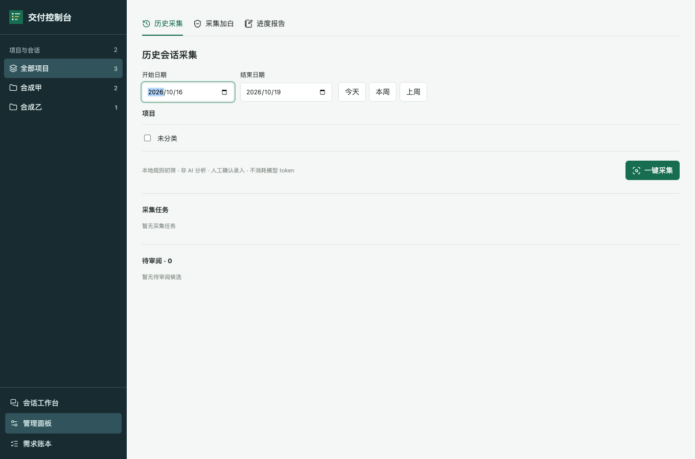

# CodexBox Delivery Console

[中文](README.md)

A local project, session, and requirement workspace for Codex. It groups sessions by the desktop's local projects, with status filters, search, sorting, details, and `codex://` navigation. Management and requirement views open on the right. Python 3.9+ is required; the server binds to loopback and performs no production deployment.

## Quick start

1. Extract `releases/需求交付控制台-0.1.0-web.zip` and run `python3 launcher.py` (or `启动交付控制台.command` on macOS).
2. Open the printed local URL, normally `http://127.0.0.1:8767/`. The first-run guide preselects the last seven calendar days and non-excluded projects. Adjust or skip it; historical input is read only after you click **Start collection**.
3. Review candidates, exclude projects, or generate reports in Management. Track status, evidence, and human decisions in the requirement ledger. Stop with `python3 stop.py`.





## Privacy and limitations

Collected excerpts, status reports, requirements, generated skills, and logs remain in `~/.local/share/delivery-console/private/`; `runtime.json` is in the parent data directory. **Never publish the data directory.** Optional project adapters are loaded only from this private location. The repository and ZIP contain no personal project records, business translations, or raw chats. See [privacy and extensions](docs/privacy.md).

Collection uses a local rule-based prefilter, not automatic AI semantic analysis. Ten-minute reconciliation detects changes in local input metadata but does not determine completion or guarantee a skill is invoked after every turn. Reported statuses and human reviews still require evidence. Approvals do not authorize production operations. Desktop indexes and protocol links depend on the local Codex version.

## Build and verify

```bash
python3 tools/package.py
python3 -m unittest discover -s tests -v
```

Package before running the tests. The ZIP and SHA-256 are written to `releases/` and copied to the desktop. Tests use temporary synthetic data. Optional browser checks need Playwright/Chromium; the application itself does not need Node. Publish from a fresh Git history, never the legacy repository history or release archives.
